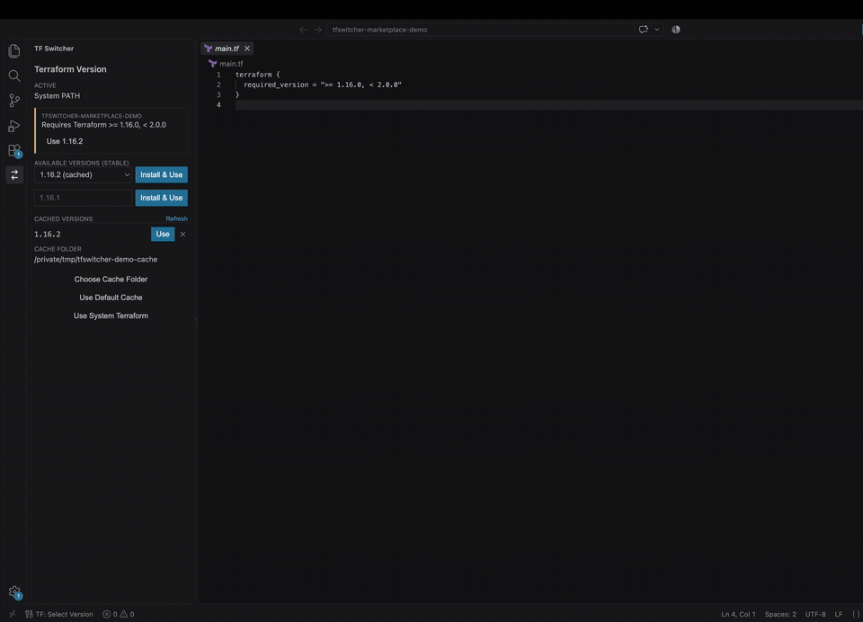

# Terraform Version Switcher for VS Code (TF Switcher)

Switch Terraform versions in Visual Studio Code without a command-line version
manager. TF Switcher is a visual Terraform version manager for Windows, macOS
and Linux, and an alternative to tools such as `tfenv` and `tfswitch`.

[Install TF Switcher from the Visual Studio Marketplace](https://marketplace.visualstudio.com/items?itemName=345Dave.tfswitcher)

## See it in action

TF Switcher reads the workspace requirement, offers a compatible Terraform
version, activates it for new VS Code terminals, and verifies the result.

## How to switch Terraform versions in VS Code

1. Open a Terraform project in VS Code.
2. Select the TF Switcher icon in the Activity Bar.
3. Choose a compatible or exact Terraform version.
4. Open a new terminal, or relaunch an existing terminal to use the selected version.

## Highlights

- Installs official Terraform releases directly from HashiCorp.
- Does not require access to GitHub when using the extension.
- Detects `required_version` constraints in Terraform workspaces.
- Reads and writes exact project versions through `.terraform-version`.
- Verifies every downloaded ZIP against HashiCorp's SHA-256 checksum.
- Imports approved Terraform ZIPs and matching checksums for offline or
  restricted-network installation.
- Changes `PATH` only for new or relaunched VS Code terminals.
- Reuses previously downloaded versions from a local cache.
- Does not collect telemetry or request Terraform credentials.

## Supported platforms

| Platform | Architectures |
| --- | --- |
| Windows | x64, ARM64, x86 |
| macOS | Apple Silicon, Intel |
| Linux | x64, ARM64, x86 |

## Frequently asked questions

### Is TF Switcher a tfenv alternative for Windows?

Yes. TF Switcher offers a visual VS Code workflow instead of a command-line
version manager. It supports Windows, macOS and Linux.

### How do I use a different Terraform version for each project?

Select a version in the project's VS Code workspace and use **Pin Active Version
to Project** to write it to `.terraform-version`. TF Switcher also reads
Terraform `required_version` constraints and recommends a compatible release.

### Can I use Terraform versions offline?

Cached versions work offline. For a version that is not cached, import its
official Terraform ZIP and matching HashiCorp checksum list from HashiCorp or a
trusted IT source.

### How are Terraform downloads verified?

TF Switcher checks each ZIP against HashiCorp's published SHA-256 checksum,
validates the archive contents, and runs the executable to confirm its version.

## Release history

### 1.16.6 - 17 September 2026

- Improved `required_version` detection by ignoring HCL comments and supporting
  Terraform JSON configuration files.
- Added `.terraform-version` project pins with a sidebar action for writing the
  active version to a project.
- Expanded release discovery so older projects receive compatible-version
  recommendations while the sidebar stays concise.

### 1.16.5 - 17 September 2026

- Added an optional Ko-fi Sponsor link to the Marketplace and VS Code extension
  details.
- Added support information and an opt-in public supporters page.
- All extension features remain free to use.

The Visual Studio Marketplace is the official installation and update source
for TF Switcher.

## Network requirements

Installing a Terraform version requires HTTPS access to
`releases.hashicorp.com`. Loading the available-version list requires access to
`api.releases.hashicorp.com`. Previously cached Terraform versions remain
available offline. If those endpoints are unavailable, use **Import Terraform
ZIP** with an official Terraform archive and its matching HashiCorp checksum
file supplied by your IT team or another trusted source.

## Support TF Switcher

TF Switcher is free to use, with all features available without contributing.
If it saves you time, [support its development on Ko-fi](https://ko-fi.com/345dave).
Optional contributions help fund maintenance, testing, and improvements.

Supporters can choose to be thanked on the [supporters page](SUPPORTERS.md).
See that page for how to opt in; recognition is entirely optional.

## Support and feedback

- [Troubleshooting guide](TROUBLESHOOTING.md)
- [Security and verification](SECURITY-VERIFICATION.md)
- [Report a bug](https://github.com/345dave/tfswitcher-docs/issues/new?template=bug_report.yml)
- [Request a feature](https://github.com/345dave/tfswitcher-docs/issues/new?template=feature_request.yml)
- [Security policy](SECURITY.md)

Do not include Terraform credentials, access tokens, internal configuration, or
other secrets in reports.

This repository contains public documentation and media for TF Switcher. The
extension's implementation repository is maintained separately.
